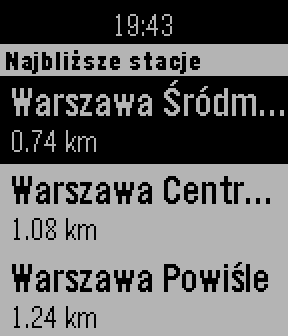
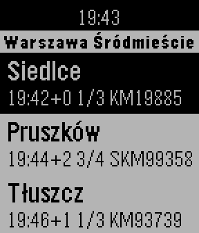
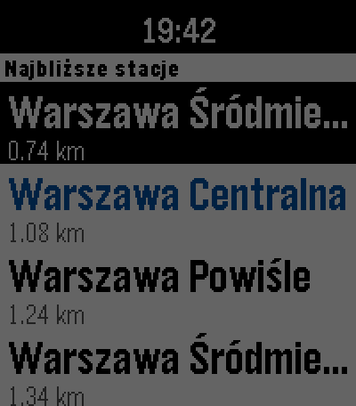
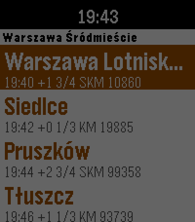

# Rozkład jazdy pociągów (Train Timetable) for PebbleOS

<table>
  <tr>
    <th>Flint (Pebble 2) — nearest stations</th>
    <th>Flint (Pebble 2) — departures</th>
  </tr>
  <tr>
    <td></td>
    <td></td>
  </tr>
  <tr>
    <th>Emery (Pebble 3) — nearest stations</th>
    <th>Emery (Pebble 3) — departures</th>
  </tr>
  <tr>
    <td></td>
    <td></td>
  </tr>
</table>

The app shows the closest stations and departures with delays, platform and track numbers. It primarily uses the custom backend in `rozklad_backend/` directory, which serves the data from the official [PKP PLK PDP API](https://pdp-api.plk-sa.pl/swagger/index.html), and falls back to the unofficial [API Bilkom](https://kalkulatorkolejowy.pl/bilkom) when the custom backend is unreachable or does not know a station. The app bases on [PebbleRail](https://github.com/jccit/pebblerail).

[Link to the Rebble Store](https://apps.rebble.io/en_US/application/68a759a7652aec0009f26c41)